# Application de gestion de stock

Application web complète (interface + API + base de données), construite pas à pas sous Windows : gestion des produits, historique des mouvements de stock, code versionné avec Git et hébergé sur GitHub.

---

## Sommaire

1. [Fonctionnalités](#1-fonctionnalités)
2. [Comment ça fonctionne (schémas)](#2-comment-ça-fonctionne-schémas)
3. [Prérequis](#3-prérequis)
4. [Installation pas à pas](#4-installation-pas-à-pas)
5. [Lancer l'application](#5-lancer-lapplication)
6. [Tester l'API avec Postman](#6-tester-lapi-avec-postman)
7. [Structure du projet et modèles de données](#7-structure-du-projet-et-modèles-de-données)
8. [API REST](#8-api-rest)
9. [Git et GitHub : mise en ligne du projet](#9-git-et-github)
10. [Erreurs rencontrées et solutions](#10-erreurs-rencontrées-et-solutions)
11. [Bonnes pratiques et suite du projet](#11-bonnes-pratiques-et-suite-du-projet)

---

## 1. Fonctionnalités

- Ajouter et supprimer des produits (nom, référence unique, quantité, prix, seuil d'alerte)
- Recherche par nom ou par référence
- Alerte visuelle (ligne rouge) quand la quantité est inférieure ou égale au seuil d'alerte
- Total par ligne (quantité × prix) et valeur totale du stock
- **Mouvements de stock** : entrées et sorties avec quantité et note, via les boutons **+** / **−** ou un formulaire dédié
- **Historique** daté de tous les mouvements (le stock initial d'un nouveau produit est enregistré automatiquement)
- **Stock jamais négatif** : une sortie supérieure au stock disponible est refusée par l'API (« Stock insuffisant »)
- **Authentification** : page de connexion (e-mail + mot de passe), jeton JWT valable 8 heures, premier compte créé = administrateur, inscriptions ensuite fermées
- **API protégée** : `/api/products` et `/api/movements` refusent toute requête sans jeton valide (erreur 401)
- **Barre du haut** avec, à droite, un **menu utilisateur** (icône de contact, nom, e-mail, rôle) donnant accès à **Changer le mot de passe** et **Déconnexion**
- **Changement de mot de passe** dans une fenêtre qui s'ouvre par-dessus la page (mot de passe actuel requis)
- **Tableau de bord** en haut de la page : nombre de produits, unités en stock, valeur totale du stock, produits en alerte, graphique des entrées et sorties des 7 derniers jours, liste des produits en alerte et 5 derniers mouvements
- **Menu latéral** de type application : en-tête avec le nom et le téléphone de la boutique, un module par page (tableau de bord, produits et catégories, mouvements de stock...), page « Bientôt disponible » pour les modules à venir, menu qui glisse par-dessus la page sur téléphone
- **Profil de la boutique** (nom, téléphone, adresse), modifiable par l'administrateur
- **Fournisseurs** : liste avec nombre de produits liés, recherche, ajout, modification, activation / désactivation et suppression (ajout, modification et suppression réservés à l'administrateur ; la suppression détache les produits sans les supprimer)
- **Clients** : liste avec recherche, ajout, modification et suppression (gestion réservée à l'administrateur)
- **Ventes (caisse)** : point de vente pour sélectionner les produits, calculer le total, enregistrer les paiements et réduire automatiquement le stock
- **Catégories de produits** : saisie avec suggestions, colonne dédiée, filtre par catégorie, recherche par catégorie
- **Export CSV** de l'inventaire et de l'historique complet des mouvements (format lisible directement par Excel en français)
- **Gestion des utilisateurs** : l'administrateur crée des comptes, choisit leur rôle (administrateur ou utilisateur), désactive un compte ou réinitialise un mot de passe
- **Rôles** : seul l'administrateur peut ajouter, modifier ou supprimer un produit, modifier le profil de la boutique et gérer les comptes
- Données enregistrées de façon durable dans MongoDB

## 2. Comment ça fonctionne (schémas)

### 2.1 Architecture générale

L'application est composée de **trois parties** qui communiquent entre elles :

```
┌──────────────────────┐        ┌──────────────────────┐        ┌──────────────────────┐
│      NAVIGATEUR      │        │       SERVEUR        │        │    BASE DE DONNÉES   │
│                      │        │                      │        │                      │
│  React (Vite)        │ HTTP   │  Node.js + Express   │ Mongo- │       MongoDB        │
│  http://localhost    │ ─────► │  http://127.0.0.1    │ ose    │  127.0.0.1:27017     │
│  :5173               │ ◄───── │  :4100  (API REST)   │ ─────► │  base : stockdb      │
│                      │  JSON  │                      │ ◄───── │  collections :       │
└──────────────────────┘        └──────────────────────┘        │  products, movements │
      frontend/                          backend/               └──────────────────────┘
```

- Le **frontend** affiche l'interface et envoie des requêtes à l'API.
- Le **backend** reçoit les requêtes, applique les règles (validation, contrôle du stock) et parle à la base.
- **MongoDB** stocke les produits et l'historique des mouvements.

Le même schéma en diagramme Mermaid (affiché automatiquement sur GitHub) :

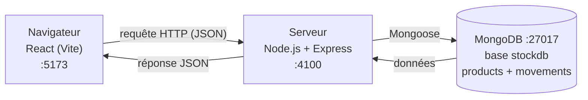

### 2.2 Que se passe-t-il quand on ajoute un produit ?

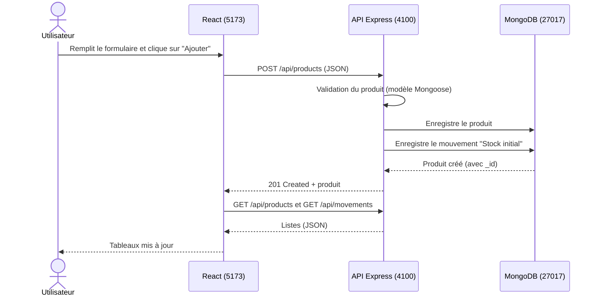

### 2.3 Que se passe-t-il quand on enregistre un mouvement de stock ?

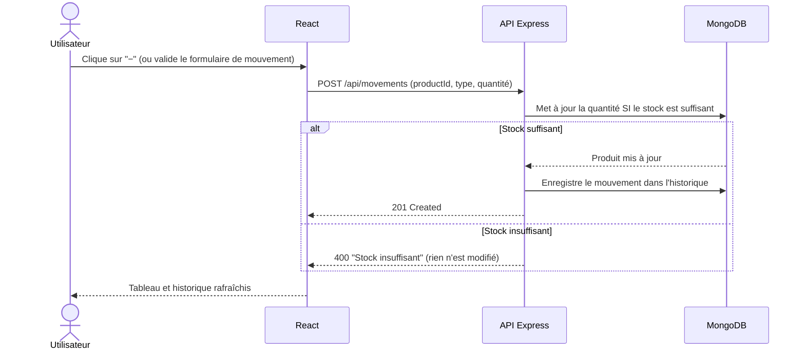

### 2.4 Comment fonctionne la connexion

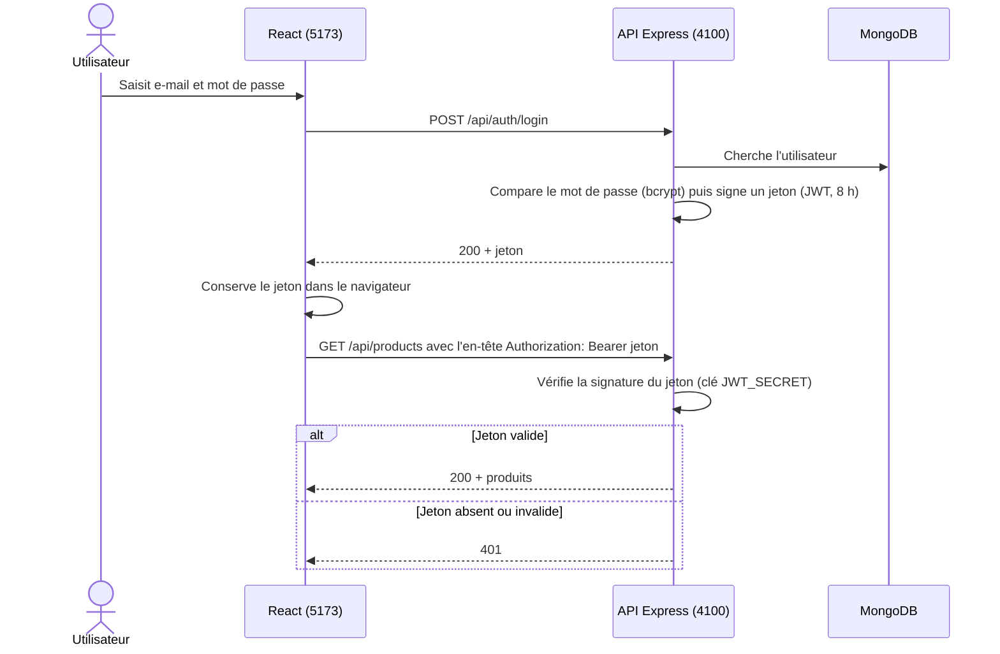

Version texte :

```
Sans jeton  ──►  GET /api/products  ──►  401 Authentification requise
Avec jeton  ──►  GET /api/products  ──►  200 + liste des produits
```

**Ne pas confondre la clé secrète et le jeton :**

| | Clé secrète (`JWT_SECRET`) | Jeton (token) |
|---|---|---|
| Rôle | Sert au **serveur** à signer et vérifier les jetons | « Ticket » prouvant qu'on est connecté |
| Où ? | Dans `backend/.env`, jamais partagée | Renvoyé par `/api/auth/login` ou `/api/auth/register` |
| Ressemble à | Une longue suite aléatoire | Un texte qui commence par `eyJ` |
| Durée | Permanente (jusqu'à changement) | 8 heures |
| À mettre dans Postman ? | **Non, jamais** | **Oui** (Bearer Token) |

### 2.5 Schéma des étapes d'installation

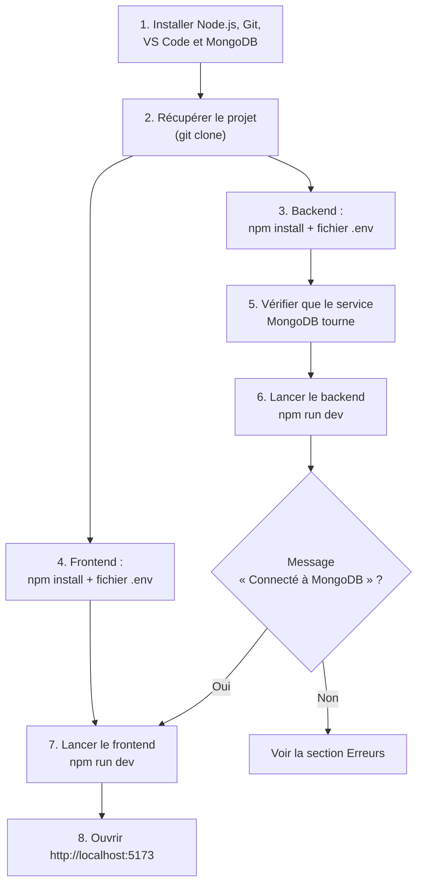

Version texte du même schéma :

```
 [1] Installer les outils (Node.js, Git, VS Code, MongoDB)
        │
        ▼
 [2] Récupérer le projet  ──────────────┐
        │                               │
        ▼                               ▼
 [3] BACKEND                      [4] FRONTEND
     npm install                      npm install
     créer backend/.env               créer frontend/.env
        │                               │
        ▼                               │
 [5] Vérifier le service MongoDB        │
        │                               │
        ▼                               │
 [6] npm run dev (backend)              │
     → "Connecté à MongoDB"             │
        │                               ▼
        └──────────────────────► [7] npm run dev (frontend)
                                        │
                                        ▼
                                 [8] http://localhost:5173
```

---

## 3. Prérequis

| Outil | Rôle | Vérification (dans PowerShell) |
|---|---|---|
| [Node.js](https://nodejs.org) (version LTS) | Exécute JavaScript côté serveur, fournit `npm` | `node -v` et `npm -v` |
| [Git](https://git-scm.com) | Versionne le code | `git --version` |
| [MongoDB Community](https://www.mongodb.com/try/download/community) | Base de données, lancée comme service Windows | `Get-Service MongoDB` (doit afficher `Running`) |
| [VS Code](https://code.visualstudio.com) | Éditeur de code (recommandé) | — |
| [Postman](https://www.postman.com/downloads) | Tester l'API (optionnel) | — |

> **Windows / PowerShell** : si `npm` affiche l'erreur « running scripts is disabled », exécute une seule fois :
> ```powershell
> Set-ExecutionPolicy -Scope CurrentUser -ExecutionPolicy RemoteSigned
> ```
> puis ferme et rouvre PowerShell.

---

## 4. Installation pas à pas

Chaque étape se termine par un **point de contrôle** : ne passe à la suivante que s'il est validé.

### Étape 1 : récupérer le projet

```powershell
git clone https://github.com/ujeneza78/Hakicool.git C:\stock-app
cd C:\stock-app
```

Le dépôt GitHub s'appelle `Hakicool` ; la commande ci-dessus le place dans le dossier `C:\stock-app`.

**Point de contrôle :** `dir` affiche les dossiers `backend`, `frontend` et `prototype`.

### Étape 2 : installer le backend

```powershell
cd C:\stock-app\backend
npm install
```

Crée ensuite le fichier **`backend/.env`** (dans VS Code : clic droit sur `backend` → *New File* → `.env`) avec ce contenu :

```
PORT=4100
MONGODB_URI=mongodb://127.0.0.1:27017/stockdb
JWT_SECRET=colle-ici-une-cle-aleatoire
```

| Variable | Signification |
|---|---|
| `PORT` | Port d'écoute de l'API. Change-le si 4100 est déjà utilisé. |
| `MONGODB_URI` | Adresse de MongoDB et nom de la base (`stockdb`, créée automatiquement au premier ajout). |
| `JWT_SECRET` | Clé secrète qui signe les jetons de connexion. Le serveur refuse de démarrer si elle manque. |

Génère une clé aléatoire (une seule fois) dans un terminal :

```powershell
node -p "require('crypto').randomBytes(48).toString('hex')"
```

Copie le résultat après `JWT_SECRET=`. Le nom doit être écrit en **majuscules**, sans espace autour du `=` et sans guillemets. Cette clé ne doit **jamais** être partagée (ni dans une capture d'écran, ni sur GitHub).

**Méthode la plus fiable pour écrire le `.env`** (génère la clé et crée le fichier en UTF-8 sans BOM, sans jamais afficher la clé) :

```powershell
cd C:\stock-app\backend
$secret = node -p "require('crypto').randomBytes(48).toString('hex')"
$content = "PORT=4100`nMONGODB_URI=mongodb://127.0.0.1:27017/stockdb`nJWT_SECRET=$secret`n"
[System.IO.File]::WriteAllText("$PWD\.env", $content, (New-Object System.Text.UTF8Encoding($false)))
(Get-Content .env) -replace '=.*','=...'
```

La dernière commande affiche uniquement les **noms** des variables : on doit voir `PORT`, `MONGODB_URI` et `JWT_SECRET`.

**Chargement du `.env` dans `server.js`** : le serveur charge toujours le `.env` situé à côté de `server.js`, quel que soit le dossier d'où il est lancé, et ce fichier remplace une éventuelle variable Windows du même nom :

```javascript
import path from "path";
import { fileURLToPath } from "url";
import dotenv from "dotenv";

const __dirname = path.dirname(fileURLToPath(import.meta.url));
dotenv.config({ path: path.join(__dirname, ".env"), override: true });
```

Au démarrage, `start()` vérifie séparément la clé et la base de données :

```javascript
async function start() {
  if (!process.env.JWT_SECRET) {
    console.error(
      "JWT_SECRET manquant. Fichier .env cherché ici : " + path.join(__dirname, ".env")
    );
    process.exit(1);
  }

  try {
    await mongoose.connect(process.env.MONGODB_URI);
    console.log("Connecté à MongoDB");
    app.listen(PORT, () => {
      console.log(`Serveur démarré sur http://localhost:${PORT}`);
    });
  } catch (error) {
    console.error("Erreur de connexion MongoDB :", error.message);
    process.exit(1);
  }
}
```

Si la clé manque, le message indique le chemin exact du `.env` cherché.

> Les lignes du `.env` s'écrivent **dans le fichier**, jamais dans le terminal. Ce fichier n'est pas envoyé sur GitHub (il est dans `.gitignore`), il faut donc le recréer à chaque nouvelle installation.

**Point de contrôle :** un dossier `node_modules` est apparu dans `backend`, et `dir -Force` montre bien un fichier `.env` (et non `.env.txt`).

### Étape 3 : installer le frontend

```powershell
cd C:\stock-app\frontend
npm install
```

Crée le fichier **`frontend/.env`** :

```
VITE_API_URL=http://127.0.0.1:4100/api
```

Le port doit être **le même** que `PORT` dans `backend/.env`. Le préfixe `VITE_` est obligatoire pour que Vite lise la variable.

**Point de contrôle :** un dossier `node_modules` est apparu dans `frontend`.

### Étape 4 : vérifier MongoDB

```powershell
Get-Service MongoDB
```

Le statut doit être `Running`. Sinon, ouvre PowerShell **en administrateur** et lance :

```powershell
net start MongoDB
```

**Point de contrôle :** `netstat -ano | findstr :27017` affiche une ligne `LISTENING`.

---

## 5. Lancer l'application

Il faut **deux terminaux ouverts en même temps**.

### Terminal 1 : l'API

```powershell
cd C:\stock-app\backend
npm run dev
```

Résultat attendu :

```
Connecté à MongoDB
Serveur démarré sur http://localhost:4100
```

Test rapide dans le navigateur : `http://127.0.0.1:4100/api/health` doit afficher `{"status":"ok", ...}`.

### Terminal 2 : l'interface

```powershell
cd C:\stock-app\frontend
npm run dev
```

Vite affiche une adresse, normalement `http://localhost:5173/`. **Ouvre l'adresse exacte affichée** (si 5173 est occupé, Vite passe à 5174, 5175...).

### Première connexion

Au premier lancement, aucun compte n'existe : la page affiche **Créer le compte administrateur**.

1. Saisir un nom, une adresse e-mail et un mot de passe de 8 caractères minimum (cocher **Afficher le mot de passe** pour contrôler la saisie).
2. Cliquer sur **Créer le compte** : le tableau de stock s'affiche, avec **Connecté : votre nom** et le bouton **Déconnexion**.
3. Ensuite, la page affiche **Connexion**, avec l'e-mail et le mot de passe choisis. Les inscriptions sont fermées.

Le jeton est conservé par le navigateur : recharger la page (`F5`) ne déconnecte pas. Au bout de 8 heures, ou après un changement de `JWT_SECRET`, il faut se reconnecter.

> Pour changer le mot de passe en étant connecté, voir la section suivante. Il n'existe pas encore de fonction « mot de passe oublié ». En cas de perte : supprimer le compte dans MongoDB Compass (base `stockdb`, collection `users`) ou avec `mongosh "mongodb://127.0.0.1:27017/stockdb" --eval "db.users.deleteMany({})"`, puis recréer le compte administrateur. Les produits et l'historique ne sont pas touchés.

### Menu utilisateur et changement de mot de passe

Une fois connecté, une **barre sombre** s'affiche en haut de la page : le titre à gauche, et à droite l'**icône de contact avec le nom** de l'utilisateur.

```
┌──────────────────────────────────────────────────────────┐
│ 📦 Gestion de stock                          (👤) Nom ▾  │
└──────────────────────────────────────────────────────────┘
                                   ┌────────────────────┐
                                   │ Nom                │
                                   │ e-mail  [Admin]    │
                                   │ 🔑 Changer le mot  │
                                   │    de passe        │
                                   │ ⎋ Déconnexion      │
                                   └────────────────────┘
```

- Le menu s'ouvre en cliquant sur l'icône, et se ferme en cliquant ailleurs ou avec `Échap`.
- **Changer le mot de passe** ouvre une **fenêtre par-dessus la page** (la page reste visible, assombrie, en arrière-plan). Elle se ferme avec **Fermer**, la croix, un clic à l'extérieur ou `Échap`.
- **Déconnexion** supprime le jeton du navigateur et ramène à la page de connexion.

Pour changer le mot de passe : saisir le mot de passe actuel, le nouveau (8 caractères minimum) et sa confirmation, puis **Enregistrer**. La case **Afficher les mots de passe** permet de contrôler la saisie.

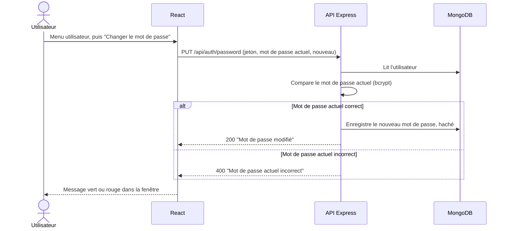

Points à connaître :

- Le serveur répond **400** (et non 401) quand le mot de passe actuel est faux : `api.js` traite tout 401 comme une session expirée et déconnecterait l'utilisateur.
- Un jeton déjà émis reste valable jusqu'à son expiration (8 heures), même après un changement de mot de passe. Les invalider serait une amélioration possible.
- Le nouveau mot de passe est toujours stocké **haché** (bcrypt).

### Tableau de bord

Le tableau de bord s'affiche en haut de la page de stock, au-dessus de la liste des produits.

```
┌─ Produits ─┐ ┌─ Unités ─┐ ┌─ Valeur du stock ─┐ ┌─ En alerte ─┐
│     12     │ │   340    │ │    1 250,00       │ │      2      │
└────────────┘ └──────────┘ └───────────────────┘ └─────────────┘
┌──────────────────────────────────┐ ┌─────────────────────────┐
│ Mouvements des 7 derniers jours  │ │ Produits en alerte      │
│  ▮▮   ▮      ▮▮     ▮            │ ├─────────────────────────┤
│  vert = entrées, rouge = sorties │ │ Derniers mouvements     │
└──────────────────────────────────┘ └─────────────────────────┘
```

| Élément | Contenu |
|---|---|
| Produits | Nombre de produits enregistrés |
| Unités en stock | Somme des quantités de tous les produits |
| Valeur totale du stock | Somme de `quantité × prix` pour chaque produit |
| Produits en alerte | Produits dont la quantité est **inférieure ou égale** au seuil d'alerte (la carte devient rouge s'il y en a) |
| Graphique | Entrées (vert) et sorties (rouge) pour chacun des 7 derniers jours, aujourd'hui compris ; une info-bulle indique le détail au survol |
| Liste d'alerte | Jusqu'à 10 produits en alerte, sous la forme `quantité / seuil`, du plus bas au plus haut |
| Derniers mouvements | Les 5 mouvements les plus récents |

Le tableau de bord se met à jour **sans recharger la page** après chaque ajout de produit, mouvement ou suppression.

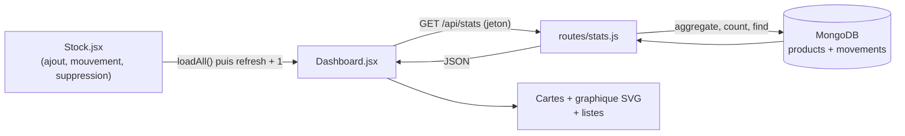

Points techniques :

- Les totaux sont calculés par **MongoDB** (`aggregate` avec `$group` et `$multiply`) et non par le navigateur.
- Les requêtes de statistiques s'exécutent en parallèle avec `Promise.all`.
- Le graphique est dessiné en **SVG**, sans bibliothèque supplémentaire : chaque barre est un rectangle positionné par un calcul.
- Les jours sont calculés avec le fuseau horaire de l'ordinateur qui exécute le serveur.
- La route `GET /api/stats` est protégée par le jeton, comme les autres.

### Navigation et menu latéral

```
┌─────────────────┬──────────────────────────────────────────┐
│ 🏪              │ ☰  Produits & catégories        (👤) Nom │
│ Nom boutique    ├──────────────────────────────────────────┤
│ 079 000 000     │                                          │
├─────────────────┤        Contenu de la page choisie        │
│ 📊 Tableau bord │                                          │
│ 🛒 Ventes       │                                          │
│ 📥 Achats       │                                          │
│ 📦 Produits     │                                          │
│ 🔄 Mouvements   │                                          │
│ 👤 Clients      │                                          │
│ 🚚 Fournisseurs │                                          │
│ 💸 Dépenses     │                                          │
│ 📈 Rapports     │                                          │
│ ─────────────── │                                          │
│ 👥 Utilisateurs │                                          │
│ ⚙️ Profil boutique                                         │
└─────────────────┴──────────────────────────────────────────┘
```

| Module | État | Contenu |
|---|---|---|
| Tableau de bord | Disponible | Cartes, graphique, alertes, derniers mouvements |
| Produits & catégories | Disponible | Liste, ajout, recherche, filtre par catégorie, export CSV |
| Mouvements de stock | Disponible | Saisie d'une entrée ou d'une sortie, historique, export CSV |
| Utilisateurs | Disponible (administrateur) | Fenêtre de gestion des comptes |
| Profil de la boutique | Disponible | Nom, téléphone, adresse |
| Ventes (caisse), Achats, Clients, Fournisseurs, Dépenses, Rapports | À venir | Page « Bientôt disponible » avec une description |

- Sur **ordinateur** (écran de 900 px de large ou plus), le menu reste affiché à gauche.
- Sur **téléphone**, le menu est caché : le bouton **☰** en haut à gauche le fait glisser par-dessus la page, avec un fond assombri. On le ferme en touchant l'extérieur, en choisissant une entrée ou avec `Échap`.
- La page affichée est mémorisée dans l'adresse (`#products`, `#movements`...) : recharger la page ou revenir en arrière conserve la bonne section.
- Le nom et le téléphone de la boutique en haut du menu viennent de la page **Profil de la boutique** (`GET /api/shop`).

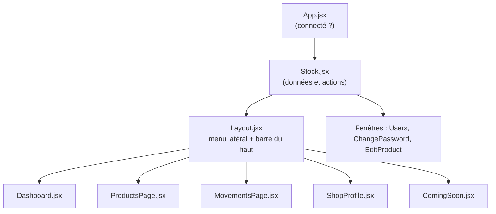

### Rôles et gestion des utilisateurs

| Action | Utilisateur | Administrateur |
|---|---|---|
| Voir les produits, l'historique et le tableau de bord | Oui | Oui |
| Enregistrer un mouvement de stock | Oui | Oui |
| Exporter les fichiers CSV | Oui | Oui |
| Ajouter, modifier ou supprimer un produit | Non (403) | Oui |
| Voir les fournisseurs | Oui | Oui |
| Ajouter, modifier ou supprimer un fournisseur | Non (403) | Oui |
| Modifier le profil de la boutique | Non (403) | Oui |
| Changer son propre mot de passe | Oui | Oui |
| Créer des comptes, changer un rôle, désactiver un compte, réinitialiser un mot de passe | Non | Oui |

Règles de sécurité :

- Le premier compte créé est administrateur ; les inscriptions libres sont ensuite fermées. Les autres comptes sont créés par l'administrateur.
- Un administrateur **ne peut pas** se retirer ses droits ni désactiver son propre compte : il reste toujours au moins un administrateur actif.
- Le rôle et l'état du compte sont lus **dans la base à chaque requête** : une promotion, une rétrogradation ou une désactivation prend effet immédiatement, sans attendre l'expiration du jeton.
- Un compte désactivé ne peut plus se connecter (403 « Compte désactivé »), et son jeton est refusé (401).
- Les contrôles sont faits **côté serveur** (`middleware/admin.js`) : masquer un bouton dans l'interface ne suffit pas à protéger une route.

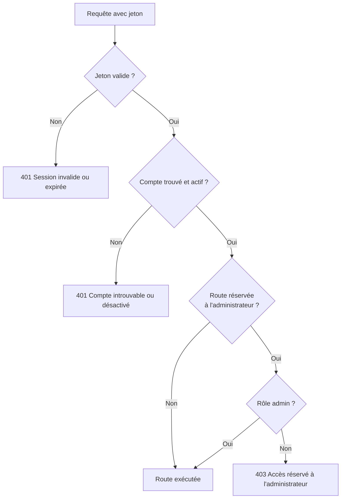

Dans l'application, l'administrateur ouvre **Gérer les utilisateurs** (menu en haut à droite ou entrée **Utilisateurs** du menu latéral). La fenêtre liste les comptes avec leur rôle et leur état, et permet de créer un compte, changer un rôle, désactiver ou activer un compte, et définir un nouveau mot de passe temporaire à communiquer à son titulaire.

### Catégories et export CSV

**Catégories** : le champ `category` du produit est une saisie libre avec **suggestions** (les catégories déjà utilisées), sans table séparée. Le tableau a une colonne **Catégorie** (`—` si elle est vide), un filtre **Toutes les catégories / Sans catégorie**, et la recherche porte aussi sur la catégorie. L'administrateur peut corriger le nom, la référence, la catégorie, le prix et le seuil d'un produit avec **Modifier** ; la quantité ne se change que par un mouvement.

**Export CSV** :

| Bouton | Route | Fichier |
|---|---|---|
| Exporter l'inventaire (CSV) | `GET /api/export/products.csv` | `inventaire-AAAA-MM-JJ.csv` : nom, référence, catégorie, quantité, prix, seuil, valeur, statut (`En alerte` ou `OK`) |
| Exporter l'historique (CSV) | `GET /api/export/movements.csv` | `mouvements-AAAA-MM-JJ.csv` : date, produit, référence, type, quantité, note (**tout** l'historique, pas seulement les 100 dernières lignes) |

- Séparateur `;` et virgule décimale, comme attend l'Excel français ; une marque d'ordre des octets (`\uFEFF`) fait afficher correctement les accents.
- Les cellules de texte qui commencent par `=`, `+`, `-` ou `@` sont neutralisées, pour qu'un nom de produit malveillant ne devienne pas une formule Excel.
- Un simple lien ne marcherait pas, car le navigateur n'enverrait pas le jeton : `api.js` télécharge le fichier avec `fetch`, puis le propose à l'enregistrement (`downloadFile`).

### Arrêter

`Ctrl + C` dans chaque terminal. Fermer un terminal arrête le serveur qu'il contient.

> `npm run dev` redémarre automatiquement le serveur à chaque modification du code. Pour une utilisation simple sans développement, `npm start` suffit.

### Ports utilisés

| Service | Port |
|---|---|
| API Express | 4100 |
| Interface React (Vite) | 5173 |
| MongoDB | 27017 |

Les ports 3000, 4000, 5500 et 8000 étaient déjà occupés sur la machine de développement. Pour vérifier si un port est libre : `netstat -ano | findstr :4100` (aucune ligne = libre).

---

## 6. Tester l'API avec Postman

Postman est indépendant de VS Code : il lui suffit que le **backend soit lancé**.

```
┌──────────────┐   requête HTTP    ┌────────────────────┐
│   Postman    │ ────────────────► │  API  127.0.0.1    │
│              │ ◄──────────────── │       :4100        │
└──────────────┘   réponse JSON    └────────────────────┘
```

### Étape préalable : obtenir un jeton

Toutes les routes `/api/products` et `/api/movements` exigent un jeton.

1. Créer une requête `POST http://127.0.0.1:4100/api/auth/login`, onglet **Authorization** sur **No Auth**.
2. Onglet **Body** → **raw** → **JSON** :

```json
{
  "email": "votre-email@exemple.com",
  "password": "votre-mot-de-passe"
}
```

3. Pour que Postman enregistre le jeton tout seul, onglet **Scripts** → **Post-response** :

```javascript
pm.globals.set("token", pm.response.json().token);
```

4. Envoyer (**Send**) : réponse **200 OK** avec un champ `token`.
5. Dans les autres requêtes, onglet **Authorization** → **Bearer Token**, et écrire dans le champ `{{token}}` (sans le mot `Bearer`).

> La ligne `pm.globals.set(...)` se colle **dans Postman**, dans la partie **Post-response** (« After response ») de l'onglet **Scripts**. Dans **Pre-request**, elle provoque l'erreur `Cannot read properties of undefined (reading 'json')` (la réponse n'existe pas encore) ; collée dans PowerShell, elle provoque une erreur de syntaxe. Après le login, l'icône en forme d'œil (Environments quick look) doit montrer `token` dans **Globals**.

Si aucun compte n'existe encore, créer le premier avec `POST /api/auth/register` et un body contenant aussi `"name"`.

### Les requêtes

| Action | Méthode | Adresse | Body |
|---|---|---|---|
| Vérifier l'API (sans jeton) | GET | `http://127.0.0.1:4100/api/health` | — |
| Créer le 1er compte (sans jeton) | POST | `http://127.0.0.1:4100/api/auth/register` | raw, JSON : `name`, `email`, `password` |
| Se connecter (sans jeton) | POST | `http://127.0.0.1:4100/api/auth/login` | raw, JSON : `email`, `password` |
| Changer son mot de passe | PUT | `http://127.0.0.1:4100/api/auth/password` | raw, JSON : `currentPassword`, `newPassword` |
| Statistiques | GET | `http://127.0.0.1:4100/api/stats` | — |
| Exporter l'inventaire | GET | `http://127.0.0.1:4100/api/export/products.csv` | — |
| Exporter l'historique | GET | `http://127.0.0.1:4100/api/export/movements.csv` | — |
| Profil de la boutique | GET / PUT | `http://127.0.0.1:4100/api/shop` | PUT (administrateur) : raw, JSON : `name`, `phone`, `address` |
| Lister les utilisateurs | GET | `http://127.0.0.1:4100/api/users` | — (administrateur) |
| Créer un utilisateur | POST | `http://127.0.0.1:4100/api/users` | raw, JSON : `name`, `email`, `password`, `role` (administrateur) |
| Lister les produits | GET | `http://127.0.0.1:4100/api/products` | — |
| Ajouter un produit | POST | `http://127.0.0.1:4100/api/products` | raw, JSON |
| Modifier un produit | PUT | `http://127.0.0.1:4100/api/products/<_id>` | raw, JSON : `{ "price": 30 }` |
| Supprimer un produit | DELETE | `http://127.0.0.1:4100/api/products/<_id>` | — |
| Lister l'historique | GET | `http://127.0.0.1:4100/api/movements` | — |
| Enregistrer un mouvement | POST | `http://127.0.0.1:4100/api/movements` | raw, JSON |

**Identifiants dans les adresses** : dans ce README, `/api/products/:id` signifie « mettre l'identifiant à cet endroit ». Les deux-points (`:`) ne se recopient **pas**. L'adresse correcte est :

```
http://127.0.0.1:4100/api/products/6afdb9f940c6220a88d5e446
```

L'identifiant (`_id`) fait exactement 24 caractères hexadécimaux ; on le récupère avec `GET /api/products`.

**Modifier la quantité** : utiliser `POST /api/movements` (entrée ou sortie) et non `PUT /api/products/<_id>`. Le mouvement est enregistré dans l'historique et le stock ne peut pas devenir négatif. Un `PUT` sur `quantity` modifie le stock sans laisser de trace ; il convient pour corriger le nom, le prix, le seuil ou la catégorie.

Body d'un ajout de produit (onglet **Body** → **raw** → **JSON**) :

```json
{
  "name": "Écran",
  "reference": "ECR-001",
  "quantity": 5,
  "price": 120,
  "threshold": 2
}
```

Body d'un mouvement (`type` vaut `"in"` pour une entrée, `"out"` pour une sortie) :

```json
{
  "productId": "<_id du produit>",
  "type": "out",
  "quantity": 2,
  "note": "Vente au comptoir"
}
```

| Code de réponse | Signification |
|---|---|
| 200 | Succès |
| 201 | Produit ou mouvement créé |
| 400 | Données invalides (champ manquant, référence déjà utilisée, stock insuffisant) |
| 401 | Jeton absent, invalide ou expiré, ou identifiants de connexion incorrects |
| 403 | Inscription refusée : un compte existe déjà |
| 404 | Produit introuvable (mauvais `_id`) |
| 500 | Erreur du serveur |

Sans Postman, on peut aussi tester en PowerShell :

```powershell
Invoke-RestMethod -Uri http://127.0.0.1:4100/api/products -Method Post -ContentType "application/json" -Body '{"name":"Clavier","reference":"CLV-001","quantity":10,"price":25.5,"threshold":3}'
```

---

## 7. Structure du projet et modèles de données

```
stock-app/
├── backend/
│   ├── middleware/
│   │   ├── auth.js           # Vérifie le jeton, l'état du compte et lit le rôle
│   │   └── admin.js          # Réserve une route à l'administrateur
│   ├── models/
│   │   ├── Product.js        # Schéma d'un produit (Mongoose)
│   │   ├── Movement.js       # Schéma d'un mouvement de stock
│   │   ├── User.js           # Schéma d'un utilisateur (rôle, état actif)
│   │   ├── Shop.js           # Profil de la boutique
│   │   ├── Supplier.js       # Schéma d'un fournisseur
│   │   └── Customer.js       # Schéma d'un client
│   ├── routes/
│   │   ├── auth.js           # 1er compte, connexion, utilisateur connecté, mot de passe
│   │   ├── Products.js       # Routes des produits (CRUD)
│   │   ├── movements.js      # Routes des mouvements (historique, entrée/sortie)
│   │   ├── stats.js          # Statistiques du tableau de bord
│   │   ├── users.js          # Gestion des comptes (administrateur)
│   │   ├── export.js         # Exports CSV (inventaire, historique)
│   │   ├── suppliers.js      # Fournisseurs (lecture pour tous, écriture administrateur)
│   │   ├── customers.js      # Clients (lecture pour tous, écriture administrateur)
│   │   ├── sales.js          # Ventes (caisse)
│   │   └── shop.js           # Profil de la boutique
│   ├── .env                  # PORT, MONGODB_URI, JWT_SECRET (non versionné)
│   ├── package.json
│   └── server.js             # Point d'entrée : connexion MongoDB puis démarrage
├── frontend/
│   ├── src/
│   │   ├── api.js            # Appels à l'API, gestion du jeton, téléchargement de fichiers
│   │   ├── App.jsx           # Choisit : page de connexion ou application
│   │   ├── Login.jsx         # Page de connexion / création du compte
│   │   ├── Stock.jsx         # Données et actions, choix de la page affichée
│   │   ├── Layout.jsx        # Menu latéral et barre du haut
│   │   ├── Dashboard.jsx     # Tableau de bord : cartes, graphique SVG, alertes
│   │   ├── ProductsPage.jsx  # Produits, catégories, recherche, filtre
│   │   ├── MovementsPage.jsx # Saisie des mouvements et historique
│   │   ├── ShopProfile.jsx   # Profil de la boutique
│   │   ├── ComingSoon.jsx    # Page « Bientôt disponible »
│   │   ├── CustomersPage.jsx # Gestion des clients
│   │   ├── SuppliersPage.jsx # Gestion des fournisseurs
│   │   ├── SalesPage.jsx     # Page de caisse (ventes)
│   │   ├── UserMenu.jsx      # Menu utilisateur en haut à droite
│   │   ├── ChangePassword.jsx # Fenêtre de changement de mot de passe
│   │   ├── EditProduct.jsx   # Fenêtre de modification d'un produit
│   │   ├── Users.jsx         # Fenêtre de gestion des utilisateurs
│   │   └── App.css           # Styles
│   ├── .env                  # Adresse de l'API (non versionné)
│   └── package.json
├── prototype/                # Première version HTML/CSS/JS, sans serveur
│   ├── index.html
│   ├── style.css
│   └── app.js
├── .gitignore                # node_modules/, .env, dist/
└── README.md
```

### Modèle `Product`

| Champ | Type | Règle |
|---|---|---|
| `name` | texte | obligatoire |
| `reference` | texte | obligatoire, **unique** |
| `category` | texte | optionnel (saisie libre avec suggestions des catégories déjà utilisées) |
| `quantity` | nombre | obligatoire, ≥ 0 |
| `price` | nombre | obligatoire, ≥ 0 |
| `threshold` | nombre | seuil d'alerte, ≥ 0 |

### Modèle `Movement`

| Champ | Type | Règle |
|---|---|---|
| `product` | identifiant | lien vers le produit, obligatoire |
| `productName`, `reference` | texte | copie du nom et de la référence (l'historique reste lisible si le produit est supprimé) |
| `type` | texte | `in` (entrée) ou `out` (sortie) |
| `quantity` | nombre entier | obligatoire, ≥ 1 |
| `note` | texte | optionnel |
| `createdAt` | date | ajoutée automatiquement |

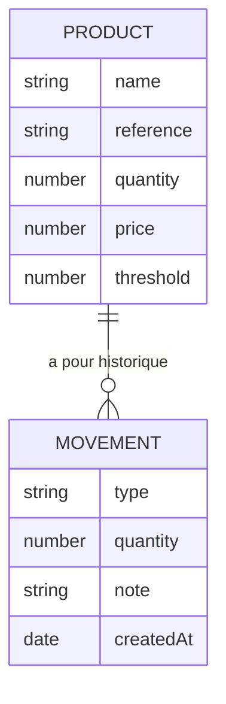

### Modèle `User`

| Champ | Type | Règle |
|---|---|---|
| `name` | texte | obligatoire |
| `email` | texte | obligatoire, **unique**, enregistré en minuscules |
| `password` | texte | **haché** avec bcrypt, jamais stocké en clair |
| `role` | texte | `admin` ou `user` (le premier compte est `admin`) |
| `active` | booléen | `true` par défaut ; un compte désactivé ne peut plus se connecter |

### Modèle `Shop`

| Champ | Type | Règle |
|---|---|---|
| `name` | texte | nom de la boutique, « Ma boutique » par défaut |
| `phone` | texte | optionnel |
| `address` | texte | optionnel |
| `key` | texte | toujours `main`, **unique** : garantit un seul profil même si deux requêtes arrivent en même temps |

Un seul document est utilisé ; il est créé automatiquement au premier accès.

---

## 8. API REST

| Méthode | Route | Action | Jeton requis |
|---|---|---|---|
| GET | `/api/health` | Vérifier que l'API répond | Non |
| GET | `/api/auth/status` | Indique si la création du premier compte est encore ouverte | Non |
| POST | `/api/auth/register` | Créer le premier compte (administrateur), refusé ensuite (403) | Non |
| POST | `/api/auth/login` | Se connecter, renvoie un jeton valable 8 heures | Non |
| GET | `/api/auth/me` | Utilisateur connecté | Oui |
| PUT | `/api/auth/password` | Changer son mot de passe (`currentPassword`, `newPassword` ; 8 caractères minimum) | Oui |
| GET | `/api/products` | Lister les produits | Oui |
| POST | `/api/products` | Ajouter un produit (crée aussi un mouvement « Stock initial » si la quantité est supérieure à 0) | Oui (administrateur) |
| PUT | `/api/products/:id` | Modifier un produit (nom, référence, catégorie, prix, seuil ; le champ `quantity` est ignoré, le stock ne change que par mouvement) | Oui (administrateur) |
| DELETE | `/api/products/:id` | Supprimer un produit | Oui (administrateur) |
| GET | `/api/movements` | Lister les 100 derniers mouvements | Oui |
| POST | `/api/movements` | Enregistrer une entrée ou une sortie (refusée si le stock est insuffisant) | Oui |
| GET | `/api/stats` | Statistiques du tableau de bord : totaux, produits en alerte, 5 derniers mouvements, entrées et sorties des 7 derniers jours | Oui |
| GET | `/api/export/products.csv` | Télécharger l'inventaire au format CSV | Oui |
| GET | `/api/export/movements.csv` | Télécharger tout l'historique des mouvements au format CSV | Oui |
| GET | `/api/shop` | Lire le profil de la boutique | Oui |
| PUT | `/api/shop` | Modifier le profil de la boutique | Oui (administrateur) |
| GET | `/api/suppliers` | Lister les fournisseurs | Oui |
| POST | `/api/suppliers` | Ajouter un fournisseur | Oui (administrateur) |
| PUT | `/api/suppliers/:id` | Modifier un fournisseur | Oui (administrateur) |
| DELETE | `/api/suppliers/:id` | Supprimer un fournisseur | Oui (administrateur) |
| GET | `/api/customers` | Lister les clients | Oui |
| POST | `/api/customers` | Ajouter un client | Oui (administrateur) |
| PUT | `/api/customers/:id` | Modifier un client | Oui (administrateur) |
| DELETE | `/api/customers/:id` | Supprimer un client | Oui (administrateur) |
| GET | `/api/sales` | Lister les ventes | Oui |
| POST | `/api/sales` | Enregistrer une vente (réduit le stock, crée les mouvements) | Oui |
| GET | `/api/users` | Lister les comptes | Oui (administrateur) |
| POST | `/api/users` | Créer un compte (`name`, `email`, `password` de 8 caractères minimum, `role`) | Oui (administrateur) |
| PUT | `/api/users/:id` | Changer le rôle ou activer / désactiver un compte (pas sur soi-même) | Oui (administrateur) |
| PUT | `/api/users/:id/password` | Réinitialiser le mot de passe d'un compte | Oui (administrateur) |

Le jeton s'envoie dans l'en-tête `Authorization: Bearer <jeton>`.

Dans les routes, `:id` désigne l'identifiant MongoDB du produit (par exemple `/api/products/6afdb9f940c6220a88d5e446`) ; les deux-points ne font pas partie de l'adresse réelle.

---

## 9. Git et GitHub

**Git** conserve l'historique du code sur le PC ; **GitHub** héberge une copie en ligne (sauvegarde, partage, point de départ du déploiement).

```
 Ton PC (Git local)                      GitHub (en ligne)
┌──────────────────────┐   git push    ┌──────────────────────┐
│ fichiers + commits   │ ────────────► │ copie du dépôt       │
│ C:\stock-app         │ ◄──────────── │ github.com/...       │
└──────────────────────┘   git clone   └──────────────────────┘
                           / git pull
```

Dépôt du projet : `https://github.com/ujeneza78/Hakicool`

### 9.1 Comment le projet a été mis sur GitHub (pas à pas)

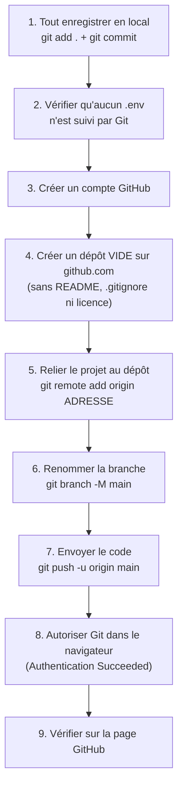

#### Étape 1 : enregistrer tout le travail en local

À la racine du projet :

```powershell
cd C:\stock-app
git status
git add .
git commit -m "Message clair"
```

**Point de contrôle :** `git status` affiche `nothing to commit, working tree clean`.

#### Étape 2 : vérifier qu'aucun secret ne part en ligne

```powershell
git ls-files | findstr ".env"
```

Cette commande **ne doit rien afficher**. Si elle liste un fichier `.env`, il ne faut pas envoyer le projet : le `.gitignore` doit contenir `.env` (et `node_modules/`) avant le premier envoi.

#### Étape 3 : créer un compte GitHub

Sur **github.com** → **Sign up** : adresse e-mail, mot de passe, **nom d'utilisateur**, puis confirmation de l'e-mail.

Le nom d'utilisateur est celui qui sert dans les adresses de dépôt (pas l'adresse e-mail). Pour le retrouver : clic sur la photo de profil en haut à droite, sous **Signed in as**. Ici : `ujeneza78`.

#### Étape 4 : créer un dépôt vide

1. Clic sur le **+** en haut à droite → **New repository**.
2. **Repository name** : le nom du dépôt (ici `Hakicool`, un nom plus parlant comme `stock-app` serait préférable).
3. Choisir **Public** (visible par tous) ou **Private** (visible par soi seul).
4. **Ne rien cocher** : ni README, ni `.gitignore`, ni licence. Ces fichiers existent déjà en local, les créer en ligne provoquerait un conflit.
5. Clic sur **Create repository**.

GitHub affiche alors l'**adresse exacte** du dépôt, au format :

```
https://github.com/<nom-utilisateur>/<nom-du-depot>.git
```

C'est cette adresse qu'il faut copier telle quelle (ici `https://github.com/ujeneza78/Hakicool.git`).

> `git push` envoie du code vers un dépôt, mais **ne le crée pas** : le dépôt doit exister avant.

#### Étape 5 : relier le projet au dépôt

```powershell
git remote add origin https://github.com/ujeneza78/Hakicool.git
git remote -v
```

`origin` est le nom donné à l'adresse du dépôt en ligne. `git remote -v` doit afficher la bonne adresse deux fois (`fetch` et `push`).

Si `origin` existe déjà avec une mauvaise adresse, utiliser `set-url` à la place de `add` :

```powershell
git remote set-url origin https://github.com/ujeneza78/Hakicool.git
```

#### Étape 6 : renommer la branche principale

```powershell
git branch -M main
```

Git avait créé une branche `master` ; GitHub utilise `main`.

#### Étape 7 : envoyer le code

```powershell
git push -u origin main
```

Le `-u` mémorise le lien entre la branche locale et la branche en ligne : ensuite, un simple `git push` suffit.

Résultat attendu à la fin :

```
To https://github.com/ujeneza78/Hakicool.git
 * [new branch]      main -> main
branch 'main' set up to track 'origin/main'.
```

#### Étape 8 : autoriser Git dans le navigateur

Au premier envoi, Git Credential Manager (installé avec Git pour Windows) ouvre le navigateur et demande de se connecter à GitHub. Après autorisation, la page affiche **Authentication Succeeded** : l'onglet peut être fermé, et l'envoi reprend dans le terminal. La connexion est mémorisée, il n'y a pas à la refaire pour les envois suivants.

> Si le terminal demande un mot de passe : GitHub n'accepte plus le mot de passe du compte en ligne de commande, il faut un jeton d'accès personnel (Settings → Developer settings → Personal access tokens).

#### Étape 9 : vérifier sur GitHub

Recharger la page du dépôt. Elle doit montrer :

- les dossiers `backend`, `frontend`, `prototype`, le fichier `.gitignore` et le `README.md` affiché en bas de page avec ses schémas
- **aucun** fichier `.env` et aucun dossier `node_modules`
- l'historique complet des commits (clic sur le nombre de commits)

### 9.2 Problèmes rencontrés pendant la mise en ligne

Dans l'ordre où ils sont apparus :

| # | Message ou symptôme | Cause | Solution |
|---|---|---|---|
| 1 | `failed to load library 'libcurl-4.dll'` et `An Application Control policy has blocked this file` | Une politique de sécurité de Windows a bloqué un composant de Git utilisé pour les connexions `https` | L'erreur ne s'est plus reproduite aux essais suivants. Si elle revient : réinstaller la dernière version de Git (git-scm.com) puis redémarrer le PC ; sinon vérifier Smart App Control, ou demander à l'administrateur du PC d'autoriser `C:\Program Files\Git`. GitHub Desktop ou l'envoi par le site (Add file → Upload files) sont des solutions de secours |
| 2 | Adresse `https://github.com/ujeneza78@gmail.com/...` | L'adresse e-mail avait été mise à la place du nom d'utilisateur | Utiliser le **nom d'utilisateur** GitHub, pas l'e-mail |
| 3 | `error: remote origin already exists` | `git remote add` relancé alors que `origin` existait déjà avec l'ancienne adresse | `git remote set-url origin <bonne-adresse>` |
| 4 | `remote: Repository not found` | L'adresse visée n'existait pas : mauvais nom d'utilisateur (`Hakicool`) et nom de dépôt (`stock-app`) qui ne correspondaient pas au dépôt réellement créé | Copier l'adresse exacte affichée sur la page du dépôt (`ujeneza78/Hakicool.git`) puis `git remote set-url` |
| 5 | Page « Authentication Succeeded » puis `Repository not found` | La connexion fonctionnait, mais l'adresse du dépôt restait fausse | Corriger l'adresse (problème 4) et relancer `git push -u origin main` |

Leçon : **toujours copier l'adresse du dépôt depuis GitHub** et vérifier avec `git remote -v` avant le premier `git push`.

### 9.3 Utilisation au quotidien

À lancer dans un terminal PowerShell, **à la racine du projet** (`C:\stock-app`) :

```powershell
git status                      # quels fichiers ont changé
git diff                        # quelles lignes ont changé (- supprimée, + ajoutée)
git add .                       # prépare tous les changements
git commit -m "Message clair"   # enregistre une version
git push                        # envoie sur GitHub
git log --oneline               # consulte l'historique (quitter avec la touche q)
```

```
Tu modifies du code ─► git add . ─► git commit -m "…" ─► git push ─► GitHub
```

- `git diff` compare les fichiers modifiés au dernier commit ; après un `git add .`, utiliser `git diff --staged`.
- Un commit s'enregistre uniquement en local : sans `git push`, GitHub ne voit rien.
- Ne commiter que du code qui fonctionne, avec un message qui décrit le changement.

### 9.4 Renommer le dépôt (facultatif)

Le dépôt s'appelle `Hakicool`. Pour lui donner un nom plus clair :

1. Sur GitHub : **Settings** → **Repository name** → saisir `stock-app` → **Rename**.
2. En local, mettre à jour l'adresse :

```powershell
git remote set-url origin https://github.com/ujeneza78/stock-app.git
git remote -v
```

GitHub redirige l'ancienne adresse vers la nouvelle, mais il vaut mieux corriger `origin` tout de suite.

### 9.5 Récupérer le projet sur une autre machine

```powershell
git clone https://github.com/ujeneza78/Hakicool.git C:\stock-app
cd C:\stock-app
```

Puis suivre la section [Installation pas à pas](#4-installation-pas-à-pas). Les fichiers `.env` et les dossiers `node_modules` ne sont pas sur GitHub : il faut recréer les `.env` et lancer `npm install` dans `backend` et `frontend`.

Pour récupérer les dernières modifications sur une machine qui possède déjà le projet :

```powershell
git pull
```

### 9.6 Historique des étapes (commits)

1. Initialisation du projet
2. Ajout du prototype HTML/CSS/JS et du serveur Express
3. Connexion MongoDB, modèle `Product` et routes CRUD
4. Frontend React connecté à l'API
5. Historique des mouvements de stock
6. Mise à jour du README
7. Authentification JWT : connexion et routes protégées
8. Page de connexion améliorée
9. Changement de mot de passe
10. Barre du haut, menu utilisateur et fenêtre de changement de mot de passe
11. Tableau de bord : statistiques, graphique et alertes
12. Gestion des utilisateurs et rôles
13. Catégories de produits et export CSV
14. Menu latéral, pages séparées et profil de la boutique
15. Gestion des clients
16. Ventes (caisse) : panier, paiement et réduction automatique du stock

### 9.7 Interfaces graphiques pour Git

Les commandes peuvent être remplacées par des boutons :

- **VS Code, panneau Source Control** (3e icône de la barre de gauche, ou `Ctrl + Maj + G`) : liste des fichiers modifiés, message de commit, boutons pour valider et pousser. C'est le plus pratique quand on code déjà dans VS Code.
- **Git GUI** (installée avec Git pour Windows) : *Browse* → choisir `C:\stock-app` → **Open**. Cycle : *Rescan*, *Stage Changed* (équivaut à `git add .`), message, *Commit*, *Push*.

Le dossier `.git` est **caché** par Windows et VS Code : il existe dans `C:\stock-app` même si on ne le voit pas. Pour le voir : `dir -Force` dans PowerShell, ou *Affichage → Afficher → Éléments masqués* dans l'Explorateur. Ne jamais le modifier ni le supprimer à la main : il contient tout l'historique.

---

## 10. Erreurs rencontrées et solutions

### Terminal Windows / PowerShell

| Erreur | Cause | Solution |
|---|---|---|
| `mkdir backend frontend` : paramètre introuvable | PowerShell n'accepte qu'un nom à la fois sans virgule | `mkdir backend, frontend` |
| `CreateDirectoryUnauthorizedAccessError` | Commande lancée dans `C:\WINDOWS\system32` (dossier protégé) | Travailler dans un dossier personnel (`C:\stock-app`) |
| `npm.ps1 cannot be loaded because running scripts is disabled` | Politique d'exécution de PowerShell | `Set-ExecutionPolicy -Scope CurrentUser -ExecutionPolicy RemoteSigned` |
| Invite `>>` qui attend la suite après `git commit` | Guillemet fermant oublié | `Ctrl + C`, puis retaper la commande complète |
| Git demande qui on est | `user.name` et `user.email` non configurés | `git config --global user.name "..."` et `git config --global user.email "..."` |
| `npm pkg set type-module` : erreur `EUSAGE` | Tiret au lieu de `=` | `npm pkg set type=module` |
| `PORT=4000 : not recognized` | Contenu du `.env` tapé dans le terminal | Écrire ces lignes dans le fichier `backend/.env` |

### Prototype HTML/CSS/JS

| Erreur | Cause | Solution |
|---|---|---|
| Le CSS ne s'applique pas | Fichier mal nommé ou mal placé (Windows masque les extensions : risque de `style.css.txt`) | Vérifier avec `dir prototype`, afficher les extensions de fichiers, recharger avec `Ctrl + F5` |

### Backend

| Erreur | Cause | Solution |
|---|---|---|
| `ERR_MODULE_NOT_FOUND` pour `routes/products.js` | `server.js` importait des fichiers pas encore créés | Créer `models/Product.js` et `routes/products.js` |
| `Missing script: "dev"` | Commandes lancées à la racine au lieu de `backend` | `cd backend` avant `npm install` / `npm run dev` ; supprimer le `package.json` et `node_modules` créés par erreur à la racine |
| `The underlying connection was closed` | Port 4000 occupé par un autre processus | Identifier avec `netstat -ano \| findstr :4000`, puis mettre `PORT=4100` dans `.env` |
| `buffering timed out after 10000ms` | `server.js` importait Mongoose mais n'appelait jamais `mongoose.connect()` | Fonction `start()` qui se connecte à MongoDB avant `app.listen()` |
| Noms incohérents | `fronteend` (faute de frappe), `product.js` au lieu de `Product.js` | `Rename-Item` ; respecter la casse (Windows l'ignore, Linux non, ce qui poserait problème au déploiement) |
| Avertissement Mongoose : l'option `new` est dépréciée | `findOneAndUpdate` et `findByIdAndUpdate` avec `{ new: true }` | Remplacer par `{ returnDocument: "after" }` dans `routes/products.js` et `routes/movements.js` |
| L'historique des mouvements est vide | Les produits créés avant la fonctionnalité n'ont pas de mouvement initial | Normal : l'historique se remplit à partir du premier mouvement (clic sur **+** / **−**) |

### Frontend

| Erreur | Cause | Solution |
|---|---|---|
| `ENOENT ... package.json` | Le dossier `frontend` était vide, le projet n'avait pas été créé | `npm create vite@latest frontend -- --template react` (option « Ignore files and continue ») |
| `localhost:5173` ne s'ouvre pas | Vite non lancé | `cd frontend`, `npm install`, `npm run dev`, puis utiliser l'adresse affichée |
| Style par défaut de Vite appliqué | `index.css` non vidé, CSS du projet absent | Vider `src/index.css` et mettre le style du projet dans `src/App.css` |
| `VITE_API_URL` non prise en compte | Vite lit le `.env` uniquement au démarrage | Arrêter puis relancer `npm run dev` |

### Git et GitHub

| Erreur | Cause | Solution |
|---|---|---|
| `failed to load library 'libcurl-4.dll'` / `An Application Control policy has blocked this file` | Une politique de sécurité de Windows a bloqué un composant de Git | L'erreur ne s'est plus reproduite aux essais suivants. Si elle revient : réinstaller la dernière version de Git (git-scm.com) puis redémarrer le PC, sinon vérifier Smart App Control ou demander à l'administrateur du PC d'autoriser `C:\Program Files\Git` |
| `remote origin already exists` | `git remote add` utilisé alors que `origin` existe déjà | `git remote set-url origin <adresse>` |
| `Repository not found` | Adresse erronée : adresse e-mail à la place du nom d'utilisateur GitHub, puis mauvais nom d'utilisateur et de dépôt | Utiliser l'adresse exacte affichée par GitHub (`https://github.com/ujeneza78/Hakicool.git`) et vérifier avec `git remote -v` |
| Dépôt vide après `git remote add` | Le dépôt doit d'abord être créé sur github.com | Créer le dépôt (sans README ni `.gitignore`), puis `git push -u origin main` |

### Authentification

| Erreur ou symptôme | Cause | Solution |
|---|---|---|
| `ERR_MODULE_NOT_FOUND` pour `routes/auth.js` | `server.js` importe un fichier absent ou créé au mauvais endroit | Créer `backend/routes/auth.js` ; vérifier avec `Test-Path routes\auth.js` |
| `auth.js` à **0 octet** dans `dir routes` | Fichier créé mais code non collé ou non enregistré | Coller le code, enregistrer avec `Ctrl + S` (le point blanc sur l'onglet doit disparaître), contrôler la taille avec `dir` |
| `ReferenceError: Cannot access 'auth' before initialization` à `middleware/auth.js:70` | Le code des **routes** a été collé dans le fichier du **middleware** (deux fichiers portent le nom `auth.js`) | `middleware/auth.js` : court, commence par `import jwt`. `routes/auth.js` : environ 70 lignes, commence par `import { Router }` |
| `JWT_SECRET manquant dans le fichier .env` (affiché sous la forme « Erreur de connexion MongoDB » dans l'ancienne version de `server.js`) | Variable absente, mal nommée (`jwt_secret` en minuscules), `.env` non relu, fichier mal placé ou `.env.txt` | Ajouter `JWT_SECRET=...` en majuscules dans `backend/.env`, puis **relancer le serveur à la main** : `--watch` ne relit pas le `.env` |
| `JWT_SECRET` « manquant » alors que la ligne existe | Mauvais encodage du fichier, caractère invisible, espace avant le `=`, serveur lancé depuis un autre dossier, ou variable Windows du même nom (même vide), que `dotenv` n'écrase pas par défaut | Récrire le `.env` avec la commande PowerShell de la section 4, et charger le fichier avec `dotenv.config({ path: ..., override: true })` dans `server.js` |
| `400` : `Cast to ObjectId failed for value ":6afd..."` | Les deux-points de la notation `/:id` ont été recopiés dans l'adresse | Retirer le `:` : `/api/products/6afdb9f940c6220a88d5e446` |
| `Session invalide ou expirée` (401) dans Postman | Le champ Token contenait autre chose qu'un jeton (un mot de passe, la clé `JWT_SECRET`, `Bearer` en double, des guillemets) | Faire un `POST /api/auth/login`, copier uniquement la valeur de `token` (qui commence par `eyJ`) ; mieux : script `pm.globals.set("token", ...)` et `{{token}}` |
| `ECONNREFUSED 127.0.0.1:8000` | Requête Postman vers un autre projet (mauvais port) | Utiliser le port **4100** |
| `Cannot GET /api/products%0A` (404) | Un retour à la ligne invisible (`%0A`) a été copié avec l'adresse | Retaper l'adresse à la main |
| `E-mail ou mot de passe incorrect` au login | Aucun compte n'existe encore, ou mauvais identifiants | Créer le compte avec `POST /api/auth/register` (body avec `name`, `email`, `password`) ou depuis la page de l'application |
| Postman refuse le jeton alors que le serveur fonctionne | Ancien en-tête `Authorization` écrasant le bon, ou jeton mal collé | Supprimer l'en-tête manuel dans l'onglet Headers ; tester d'abord avec PowerShell pour isoler le problème |
| Pas de page de connexion (ancien tableau + erreur « Authentification requise ») | `api.js`, `Login.jsx` et `Stock.jsx` absents de `frontend/src`, `App.jsx` ancien | Créer les trois fichiers et remplacer `App.jsx` ; vérifier avec `dir` |
| « Mot de passe incorrect » dans le formulaire | Faute de saisie (clavier, `@` avec `Alt Gr`, majuscules) | Cocher **Afficher le mot de passe** ; en dernier recours, supprimer le compte dans la collection `users` et le recréer |
| `Cannot PUT /api/auth/password` (404) | La route n'a pas été ajoutée à `routes/auth.js`, ou le serveur n'a pas redémarré | Ajouter la route **avant** `export default router;`, enregistrer (`Ctrl + S`) et vérifier que le serveur redémarre |
| Déconnexion automatique quand le mot de passe actuel est faux | La route renvoyait 401, que `api.js` interprète comme une session expirée | La route répond **400** « Mot de passe actuel incorrect » |
| L'ancien en-tête (« Connecté : nom » avec deux boutons, sur fond vert) s'affiche au lieu de la barre du haut | `Stock.jsx` n'a pas été entièrement mis à jour, ou le CSS `topbar` est absent de `App.css` | Remplacer **tout** le contenu de `Stock.jsx` plutôt que faire des retouches ; vérifier avec `Select-String -Path App.css -Pattern "topbar"` |
| Page blanche, console : `Failed to resolve import "./UserMenu"` | `UserMenu.jsx` ou `ChangePassword.jsx` absent de `frontend/src`, nom mal écrit, ou fichier à 0 octet | Vérifier avec `dir` dans `frontend\src`, recréer le fichier, enregistrer avec `Ctrl + S` |
| Test PowerShell : « mot de passe incorrect », puis `Session invalide ou expirée` sur la commande suivante | La connexion a échoué (valeurs d'exemple recopiées, ou mot de passe changé depuis), mais la variable `$r` contenait encore un **ancien jeton** d'un test précédent | Réinitialiser `$r = $null`, saisir les identifiants avec `Read-Host` (version du test ci-dessus), utiliser le **nouveau** mot de passe s'il a été changé |
| « Tableau de bord indisponible : ... » | Route `/api/stats` absente de `server.js` ou serveur non redémarré, jeton expiré, ou erreur côté serveur | Vérifier `app.use("/api/stats", auth, statsRoutes);` et l'import, lire le terminal du backend, se reconnecter |
| Page blanche, console : `Failed to resolve import "./Dashboard"` | `Dashboard.jsx` absent de `frontend/src` ou à 0 octet | Recréer le fichier, enregistrer, vérifier avec `dir` |
| Cartes à 0 et graphique vide | Aucun produit ni mouvement récent | Normal : ajouter un produit, puis cliquer sur **+** ou **−** |
| Postman : `There was an error in evaluating the pre-request script`, `Cannot read properties of undefined (reading 'json')` | Le script `pm.globals.set(...)` a été mis dans **Pre-request**, qui s'exécute avant que la réponse existe | Le déplacer dans **Post-response** (« After response ») de l'onglet Scripts de la requête de login |
| PowerShell : `Unexpected token 'pm.response.json'`, `Missing closing ')'` | La ligne `pm.globals.set(...)`, destinée à Postman, a été collée dans le terminal | La coller dans Postman, onglet **Scripts** ; le terminal sert aux commandes `npm`, `git`, `dir` |
| `404` : `Cannot POST /api/login` | Il manque `/auth` dans l'adresse | `http://127.0.0.1:4100/api/auth/login` |
| Le login réussit mais `{{token}}` est refusé | Script non enregistré (`Ctrl + S`) ou mal placé, variable `token` d'un environnement Postman qui masque la globale, ancien en-tête `Authorization` manuel | Vérifier `token` dans **Globals**, choisir « No Environment », supprimer l'en-tête manuel ; tester avec la Console de Postman et avec le test PowerShell |
| `400` : `E11000 duplicate key error ... reference_1 dup key` | La **référence** du produit existe déjà (champ unique) | Choisir une autre référence, ou ajouter du stock au produit existant avec un mouvement |
| `403` : `Accès réservé à l'administrateur` | Le compte n'est pas administrateur (modification ou suppression d'un produit, gestion des comptes, profil de la boutique) | Utiliser un compte administrateur |
| `401` : `Compte introuvable ou désactivé` | Le compte a été désactivé ou supprimé | L'administrateur le réactive dans **Gérer les utilisateurs** |

### Interface : menu latéral, pages et gestion des utilisateurs

| Erreur ou symptôme | Cause | Solution |
|---|---|---|
| Écran Vite : `Failed to resolve import "./Users"` (ou `./ProductsPage`, `./Layout`, `./Dashboard`...) | Le fichier importé n'existe pas dans `frontend/src`, son nom est mal écrit, ou il est à 0 octet | Créer le fichier, l'enregistrer (`Ctrl + S`) et vérifier avec une boucle sur `dir` que **tous** les fichiers attendus sont présents (liste de la section 7) |
| Un long bloc PowerShell collé dans le terminal (création de plusieurs fichiers) n'a pas créé les fichiers | Les collages multi-lignes avec des blocs `@' ... '@` sont mal gérés par le terminal | Créer les fichiers dans VS Code (clic droit sur `src` → New File), ou les copier depuis des fichiers fournis |
| L'entrée « Gérer les utilisateurs » n'apparaît pas | Le compte n'est pas administrateur, ou `UserMenu.jsx` / `Stock.jsx` n'a pas été remplacé | Se connecter avec un compte administrateur ; remplacer les deux fichiers par leur dernière version |
| Le menu latéral n'apparaît pas, ou l'ancienne page s'affiche | `Stock.jsx` ou `App.css` n'ont pas été mis à jour | Remplacer **tout** `Stock.jsx` ; vérifier que `App.css` contient `sidebar` avec `Select-String -Path App.css -Pattern "sidebar"` |
| Le nom de la boutique reste « Ma boutique » | `models/Shop.js`, `routes/shop.js` ou `app.use("/api/shop", auth, shopRoutes)` manquant, ou profil non enregistré | Vérifier les deux fichiers et `server.js`, puis enregistrer le profil depuis la page **Profil de la boutique** |
| Le téléchargement du CSV échoue | Route `/api/export` non branchée dans `server.js`, jeton expiré, ou `downloadFile` absent de `api.js` | Vérifier l'import et `app.use("/api/export", auth, exportRoutes)`, se reconnecter, remplacer `api.js` |
| Import du modèle `Movement` absent dans `routes/Products.js` (corrigé) | Le modèle était utilisé sans être importé, ce qui provoque une erreur à l'exécution | Vérifier que `import Movement from "../models/Movement.js";` figure en tête du fichier |
| Imports qui ne correspondent pas à la casse des fichiers (corrigé) | Windows ignore la casse, pas Linux : `product.js`, `suppliers.js` et `products.js` ne correspondaient pas aux imports | Renommer les fichiers (`Product.js`, `Supplier.js`, `Products.js`) et garder la même casse dans les `import` |
| Un non-administrateur voit le formulaire d'ajout de produit | Le formulaire n'était pas masqué (corrigé) | Le formulaire n'apparaît que pour l'administrateur ; le serveur refuse de toute façon la requête (403) |
| Un compte désactivé garde accès tant que son jeton est valide | Le serveur ne relisait pas l'état du compte (corrigé) | Le middleware relit `role` et `active` en base à chaque requête |
| Les accents s'affichent mal dans Excel | Fichier ouvert sans marque UTF-8 | Ouvrir le fichier téléchargé directement ; la route envoie `\uFEFF` en début de fichier |
| La page **Fournisseurs** affiche « Bientôt disponible », et les boutons Activer / Désactiver semblent sans effet (corrigé) | Dans le menu, l'identifiant était `supplier` au singulier et l'entrée portait `soon: true`, alors que la page attend `suppliers` ; le lien `#supplier` ne correspondait à aucune page | Dans `Layout.jsx`, l'entrée du menu doit être `id: "suppliers"` sans `soon` ; le bouton Activer / Désactiver fonctionne ensuite normalement |

### Arbre de diagnostic rapide

Test PowerShell qui isole le problème (le jeton passe d'une commande à l'autre sans copie) :

```powershell
$r = $null
$email = Read-Host "E-mail"
$secure = Read-Host "Mot de passe" -AsSecureString
$plain = [System.Net.NetworkCredential]::new("", $secure).Password
$body = @{ email = $email; password = $plain } | ConvertTo-Json
$r = Invoke-RestMethod -Uri http://127.0.0.1:4100/api/auth/login -Method Post -ContentType "application/json" -Body $body
$r.token.Length
Invoke-RestMethod -Uri http://127.0.0.1:4100/api/products -Headers @{ Authorization = "Bearer $($r.token)" }
```

Si la liste des produits s'affiche, le serveur est correct : le problème vient de la saisie ou de Postman.

Diagnostic du `.env` (n'affiche jamais les valeurs) :

```powershell
cd C:\stock-app\backend
Get-ChildItem -Force | Where-Object Name -like ".env*"
(Get-Content .env) -replace '=.*','=...'
Get-ChildItem Env:JWT_SECRET -ErrorAction SilentlyContinue
```

- La première commande doit lister un seul fichier `.env` (ni `.env.txt`, ni doublon).
- La deuxième doit montrer les trois noms `PORT`, `MONGODB_URI` et `JWT_SECRET`.
- La troisième ne doit rien afficher ; sinon, une variable d'environnement Windows du même nom existe et peut masquer celle du fichier.

Changer `JWT_SECRET` invalide tous les jetons existants : l'application redemande simplement la connexion, et dans Postman il faut refaire un `POST /api/auth/login`. Le compte et les données ne sont pas touchés.

### Arbre de diagnostic rapide

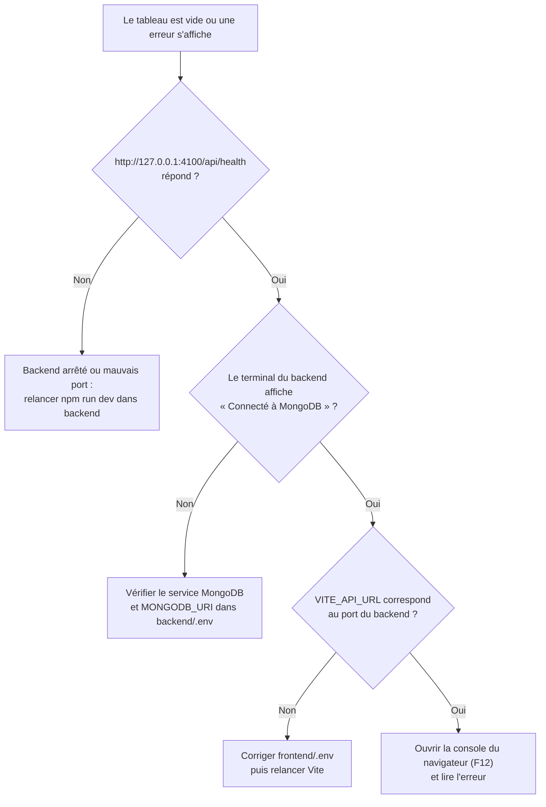

---

## 11. Bonnes pratiques et suite du projet

### Bonnes pratiques retenues

- Ne jamais versionner le fichier `.env` (il est dans `.gitignore`). Vérification : `git ls-files | findstr ".env"` ne doit rien afficher.
- Vérifier le dossier courant dans l'invite (`PS C:\stock-app\backend>`) avant de lancer `npm`.
- Lire le premier message d'erreur en entier : il indique presque toujours le fichier ou la ligne en cause.
- Utiliser `127.0.0.1` plutôt que `localhost` si une connexion échoue (problème possible d'IPv6).
- Contrôler les règles métier **côté serveur** (par exemple le stock insuffisant) : l'interface seule ne suffit pas, l'API peut être appelée directement.
- Faire des commits réguliers avec des messages clairs, et ne commiter que du code qui fonctionne.
- Ne jamais partager de capture d'écran montrant un mot de passe, un jeton ou le contenu du `.env`. Si une clé `JWT_SECRET` a été exposée, en générer une nouvelle et relancer le serveur (les utilisateurs devront se reconnecter).
- Ne jamais mettre `JWT_SECRET` dans Postman : seul le **jeton** renvoyé par la connexion s'y utilise.
- Stocker les mots de passe uniquement **hachés** (bcrypt) et renvoyer le même message d'erreur pour un mauvais e-mail ou un mauvais mot de passe.
- Après toute modification du `.env`, relancer le serveur à la main.
- Séparer les contrôles au démarrage (clé secrète, puis base de données) et afficher des messages d'erreur précis, avec le chemin du fichier cherché : cela évite de chercher la cause au mauvais endroit.
- Dans une adresse d'API, ne recopier que l'identifiant : les deux-points de la notation `/:id` ne font pas partie de l'adresse.
- Modifier un stock par un mouvement (`/api/movements`) plutôt que par un `PUT` : l'historique reste complet.
- Quand plusieurs retouches successives dans un même fichier échouent, **remplacer le fichier entier** par la version complète : c'est plus sûr que de modifier quatre endroits à la main.
- Après avoir créé un fichier, vérifier sa taille avec `dir` : un fichier à 0 octet n'a pas été enregistré (`Ctrl + S`).
- Choisir le bon code de réponse HTTP : 400 pour une donnée erronée, 401 uniquement pour une session invalide ou absente.
- Pour tester l'API en PowerShell, saisir le mot de passe avec `Read-Host -AsSecureString` : il n'apparaît ni dans la commande ni dans les captures d'écran.
- Réinitialiser les variables de test (`$r = $null`) avant chaque essai, pour ne pas réutiliser un ancien jeton sans s'en rendre compte.
- Laisser la base de données faire les calculs lourds (`aggregate`) plutôt que de charger toutes les données dans le navigateur.
- En cas de doute sur un jeton ou une adresse, tester d'abord avec PowerShell pour savoir si le problème vient du serveur ou de l'outil.
- Chaque outil a son propre langage : les lignes `pm.` vont dans Postman, les commandes `npm`, `git` et `dir` dans le terminal, le code `jsx` dans les fichiers du projet.
- Lire le rôle et l'état d'un compte dans la base à chaque requête, plutôt que de se fier à ce que contient le jeton : une désactivation prend ainsi effet immédiatement.
- Protéger les routes sensibles côté serveur (`requireAdmin`) : l'interface peut masquer un bouton, mais seule l'API garantit la sécurité.
- Empêcher un administrateur de se retirer ses droits ou de désactiver son propre compte, pour qu'il reste toujours un administrateur.
- Ne jamais recopier les valeurs d'exemple (`votre-email`, `votre-mot-de-passe`) : les remplacer par les vraies, sans les partager.
- Quand plusieurs fichiers doivent être créés, vérifier ensuite qu'ils existent tous (boucle `Test-Path` ou `dir`) plutôt que de corriger une erreur d'import à la fois.
- Pour les exports CSV, neutraliser les cellules qui commencent par `=`, `+`, `-` ou `@` et utiliser le format du pays (`;` et virgule décimale en français).
- Garder une règle d'unicité sur les références produits : le message `E11000` signifie que la protection fonctionne.

### Prochaines étapes possibles

- Mouvements de stock atomiques : l'écriture du stock et celle de l'historique ne sont pas dans une transaction ; une transaction MongoDB demande un replica set
- Invalidation des anciens jetons après un changement de mot de passe
- Filtres du tableau de bord (période, catégorie) et autres graphiques
- Fournisseurs, puis achats (réception de marchandises qui ajoute le stock et garde le coût)
- Clients et ventes (caisse) : choisir des produits, valider, retirer le stock automatiquement
- Dépenses et rapports (ventes, achats, bénéfices par période)
- Limitation du nombre de tentatives de connexion
- Jeton dans un cookie `httpOnly` plutôt que dans le navigateur (plus sûr en production)
- Application installable sur téléphone (PWA), après le déploiement
- Renommer le dépôt GitHub en `stock-app`
- Déploiement (MongoDB Atlas pour la base, hébergement du backend et du frontend)
