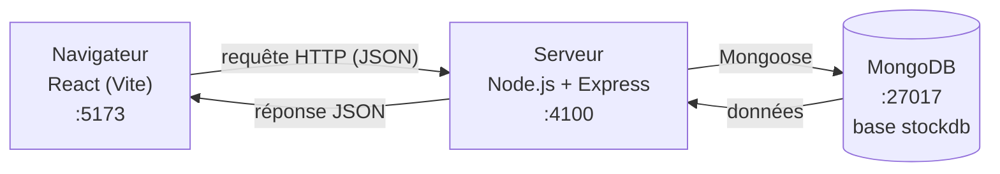
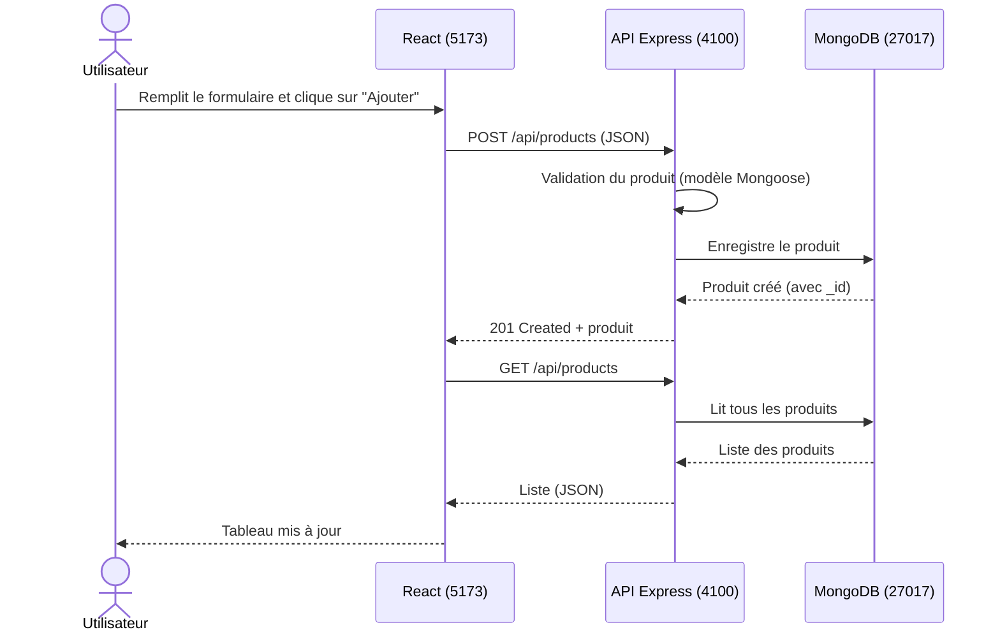
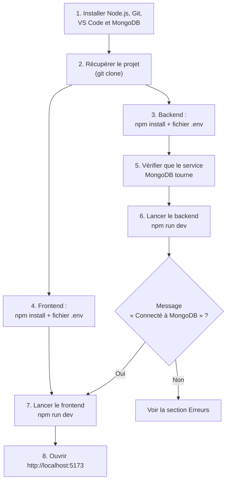
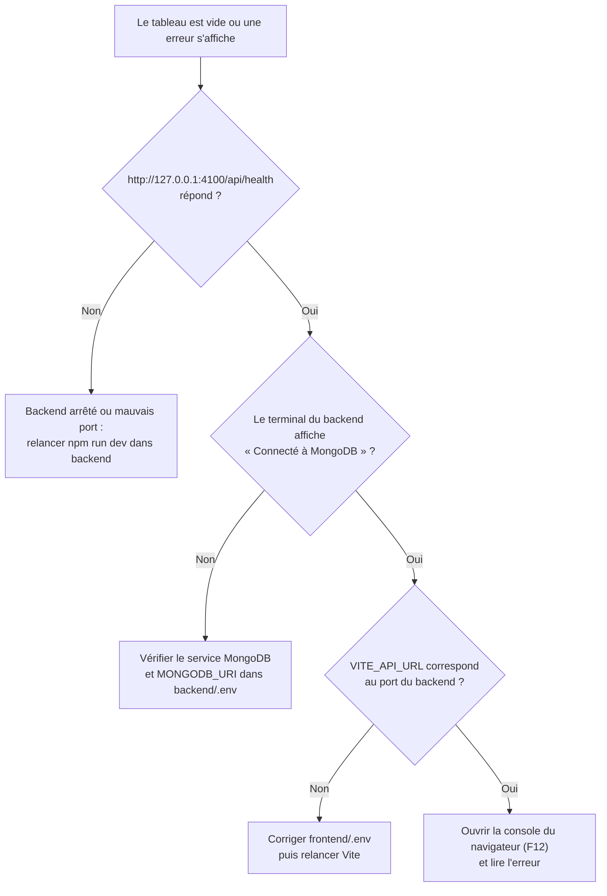

# Application de gestion de stock

Application web complète (interface + API + base de données), construite pas à pas sous Windows.

---

## Sommaire

1. [Fonctionnalités](#1-fonctionnalités)
2. [Comment ça fonctionne (schémas)](#2-comment-ça-fonctionne-schémas)
3. [Prérequis](#3-prérequis)
4. [Installation pas à pas](#4-installation-pas-à-pas)
5. [Lancer l'application](#5-lancer-lapplication)
6. [Tester l'API avec Postman](#6-tester-lapi-avec-postman)
7. [Structure du projet](#7-structure-du-projet)
8. [API REST](#8-api-rest)
9. [Erreurs rencontrées et solutions](#9-erreurs-rencontrées-et-solutions)
10. [Bonnes pratiques et suite du projet](#10-bonnes-pratiques-et-suite-du-projet)

---

## 1. Fonctionnalités

- Ajouter, modifier (quantité + / −) et supprimer des produits
- Recherche par nom ou par référence
- Alerte visuelle (ligne rouge) quand la quantité est inférieure ou égale au seuil d'alerte
- Total par ligne (quantité × prix) et valeur totale du stock
- Données enregistrées de façon durable dans MongoDB

## 2. Comment ça fonctionne (schémas)

### 2.1 Architecture générale

L'application est composée de **trois parties** qui communiquent entre elles :

```
┌──────────────────────┐        ┌──────────────────────┐        ┌──────────────────────┐
│      NAVIGATEUR      │        │       SERVEUR        │        │    BASE DE DONNÉES   │
│                      │        │                      │        │                      │
│  React (Vite)        │ HTTP   │  Node.js + Express   │ Mongo- │       MongoDB        │
│  http://localhost    │ ─────► │  http://127.0.0.1    │ ose    │  127.0.0.1:27017     │
│  :5173               │ ◄───── │  :4100  (API REST)   │ ─────► │  base : stockdb      │
│                      │  JSON  │                      │ ◄───── │                      │
└──────────────────────┘        └──────────────────────┘        └──────────────────────┘
      frontend/                          backend/                      service Windows
```

- Le **frontend** affiche l'interface et envoie des requêtes à l'API.
- Le **backend** reçoit les requêtes, applique les règles (validation) et parle à la base.
- **MongoDB** stocke les produits.

La même architecture en diagramme Mermaid (affiché automatiquement sur GitHub) :



### 2.2 Que se passe-t-il quand on ajoute un produit ?



### 2.3 Schéma des étapes d'installation



Version texte du même schéma :

```
 [1] Installer les outils (Node.js, Git, VS Code, MongoDB)
        │
        ▼
 [2] Récupérer le projet  ──────────────┐
        │                               │
        ▼                               ▼
 [3] BACKEND                      [4] FRONTEND
     npm install                      npm install
     créer backend/.env               créer frontend/.env
        │                               │
        ▼                               │
 [5] Vérifier le service MongoDB        │
        │                               │
        ▼                               │
 [6] npm run dev (backend)              │
     → "Connecté à MongoDB"             │
        │                               ▼
        └──────────────────────► [7] npm run dev (frontend)
                                        │
                                        ▼
                                 [8] http://localhost:5173
```

---

## 3. Prérequis

| Outil | Rôle | Vérification (dans PowerShell) |
|---|---|---|
| [Node.js](https://nodejs.org) (version LTS) | Exécute JavaScript côté serveur, fournit `npm` | `node -v` et `npm -v` |
| [Git](https://git-scm.com) | Versionne le code | `git --version` |
| [MongoDB Community](https://www.mongodb.com/try/download/community) | Base de données, lancée comme service Windows | `Get-Service MongoDB` (doit afficher `Running`) |
| [VS Code](https://code.visualstudio.com) | Éditeur de code (recommandé) | — |
| [Postman](https://www.postman.com/downloads) | Tester l'API (optionnel) | — |

> **Windows / PowerShell** : si `npm` affiche l'erreur « running scripts is disabled », exécute une seule fois :
> ```powershell
> Set-ExecutionPolicy -Scope CurrentUser -ExecutionPolicy RemoteSigned
> ```
> puis ferme et rouvre PowerShell.

---

## 4. Installation pas à pas

Chaque étape se termine par un **point de contrôle** : ne passe à la suivante que s'il est validé.

### Étape 1 : récupérer le projet

```powershell
git clone <adresse-du-depot> C:\stock-app
cd C:\stock-app
```

Si tu n'as pas de dépôt distant, copie simplement le dossier du projet dans `C:\stock-app`.

**Point de contrôle :** `dir` affiche les dossiers `backend`, `frontend` et `prototype`.

### Étape 2 : installer le backend

```powershell
cd C:\stock-app\backend
npm install
```

Crée ensuite le fichier **`backend/.env`** (dans VS Code : clic droit sur `backend` → *New File* → `.env`) avec ce contenu :

```
PORT=4100
MONGODB_URI=mongodb://127.0.0.1:27017/stockdb
```

| Variable | Signification |
|---|---|
| `PORT` | Port d'écoute de l'API. Change-le si 4100 est déjà utilisé. |
| `MONGODB_URI` | Adresse de MongoDB et nom de la base (`stockdb`, créée automatiquement au premier ajout). |

> Les lignes du `.env` s'écrivent **dans le fichier**, jamais dans le terminal.

**Point de contrôle :** un dossier `node_modules` est apparu dans `backend`, et `dir -Force` montre bien un fichier `.env` (et non `.env.txt`).

### Étape 3 : installer le frontend

```powershell
cd C:\stock-app\frontend
npm install
```

Crée le fichier **`frontend/.env`** :

```
VITE_API_URL=http://127.0.0.1:4100/api
```

Le port doit être **le même** que `PORT` dans `backend/.env`. Le préfixe `VITE_` est obligatoire pour que Vite lise la variable.

**Point de contrôle :** un dossier `node_modules` est apparu dans `frontend`.

### Étape 4 : vérifier MongoDB

```powershell
Get-Service MongoDB
```

Le statut doit être `Running`. Sinon, ouvre PowerShell **en administrateur** et lance :

```powershell
net start MongoDB
```

**Point de contrôle :** `netstat -ano | findstr :27017` affiche une ligne `LISTENING`.

---

## 5. Lancer l'application

Il faut **deux terminaux ouverts en même temps**.

### Terminal 1 : l'API

```powershell
cd C:\stock-app\backend
npm run dev
```

Résultat attendu :

```
Connecté à MongoDB
Serveur démarré sur http://localhost:4100
```

Test rapide dans le navigateur : `http://127.0.0.1:4100/api/health` doit afficher `{"status":"ok", ...}`.

### Terminal 2 : l'interface

```powershell
cd C:\stock-app\frontend
npm run dev
```

Vite affiche une adresse, normalement `http://localhost:5173/`. **Ouvre l'adresse exacte affichée** (si 5173 est occupé, Vite passe à 5174, 5175...).

### Arrêter

`Ctrl + C` dans chaque terminal. Fermer un terminal arrête le serveur qu'il contient.

> `npm run dev` redémarre automatiquement le serveur à chaque modification du code. Pour une utilisation simple sans développement, `npm start` suffit.

### Ports utilisés

| Service | Port |
|---|---|
| API Express | 4100 |
| Interface React (Vite) | 5173 |
| MongoDB | 27017 |

Les ports 3000, 4000, 5500 et 8000 étaient déjà occupés sur la machine de développement. Pour vérifier si un port est libre : `netstat -ano | findstr :4100` (aucune ligne = libre).

---

## 6. Tester l'API avec Postman

Postman est indépendant de VS Code : il lui suffit que le **backend soit lancé**.

```
┌──────────────┐   requête HTTP    ┌────────────────────┐
│   Postman    │ ────────────────► │  API  127.0.0.1    │
│              │ ◄──────────────── │       :4100        │
└──────────────┘   réponse JSON    └────────────────────┘
```

| Action | Méthode | Adresse | Body |
|---|---|---|---|
| Vérifier l'API | GET | `http://127.0.0.1:4100/api/health` | — |
| Lister les produits | GET | `http://127.0.0.1:4100/api/products` | — |
| Ajouter un produit | POST | `http://127.0.0.1:4100/api/products` | raw, JSON (voir ci-dessous) |
| Modifier un produit | PUT | `http://127.0.0.1:4100/api/products/<_id>` | raw, JSON : `{ "quantity": 15 }` |
| Supprimer un produit | DELETE | `http://127.0.0.1:4100/api/products/<_id>` | — |

Body d'un ajout (onglet **Body** → **raw** → **JSON**) :

```json
{
  "name": "Écran",
  "reference": "ECR-001",
  "quantity": 5,
  "price": 120,
  "threshold": 2
}
```

| Code de réponse | Signification |
|---|---|
| 200 | Succès |
| 201 | Produit créé |
| 400 | Données invalides (champ manquant, référence déjà utilisée) |
| 404 | Produit introuvable (mauvais `_id`) |
| 500 | Erreur du serveur |

Sans Postman, on peut aussi tester en PowerShell :

```powershell
Invoke-RestMethod -Uri http://127.0.0.1:4100/api/products -Method Post -ContentType "application/json" -Body '{"name":"Clavier","reference":"CLV-001","quantity":10,"price":25.5,"threshold":3}'
```

---

## 7. Structure du projet

```
stock-app/
├── backend/
│   ├── models/
│   │   └── Product.js        # Schéma d'un produit (Mongoose)
│   ├── routes/
│   │   └── products.js       # Routes de l'API (CRUD)
│   ├── .env                  # Variables de configuration (non versionné)
│   ├── package.json
│   └── server.js             # Point d'entrée : connexion MongoDB puis démarrage
├── frontend/
│   ├── src/
│   │   ├── App.jsx           # Composant principal (liste, formulaire, recherche)
│   │   └── App.css           # Styles
│   ├── .env                  # Adresse de l'API (non versionné)
│   └── package.json
├── prototype/                # Première version HTML/CSS/JS, sans serveur
│   ├── index.html
│   ├── style.css
│   └── app.js
├── .gitignore                # node_modules/, .env, dist/
└── README.md
```

Modèle d'un produit :

| Champ | Type | Règle |
|---|---|---|
| `name` | texte | obligatoire |
| `reference` | texte | obligatoire, **unique** |
| `category` | texte | optionnel |
| `quantity` | nombre | obligatoire, ≥ 0 |
| `price` | nombre | obligatoire, ≥ 0 |
| `threshold` | nombre | seuil d'alerte, ≥ 0 |

---

## 8. API REST

| Méthode | Route | Action |
|---|---|---|
| GET | `/api/health` | Vérifier que l'API répond |
| GET | `/api/products` | Lister les produits |
| POST | `/api/products` | Ajouter un produit |
| PUT | `/api/products/:id` | Modifier un produit |
| DELETE | `/api/products/:id` | Supprimer un produit |

---

## 9. Erreurs rencontrées et solutions

### Terminal Windows / PowerShell

| Erreur | Cause | Solution |
|---|---|---|
| `mkdir backend frontend` : paramètre introuvable | PowerShell n'accepte qu'un nom à la fois sans virgule | `mkdir backend, frontend` |
| `CreateDirectoryUnauthorizedAccessError` | Commande lancée dans `C:\WINDOWS\system32` (dossier protégé) | Travailler dans un dossier personnel (`C:\stock-app`) |
| `npm.ps1 cannot be loaded because running scripts is disabled` | Politique d'exécution de PowerShell | `Set-ExecutionPolicy -Scope CurrentUser -ExecutionPolicy RemoteSigned` |
| Invite `>>` qui attend la suite après `git commit` | Guillemet fermant oublié | `Ctrl + C`, puis retaper la commande complète |
| Git demande qui on est | `user.name` et `user.email` non configurés | `git config --global user.name "..."` et `git config --global user.email "..."` |
| `npm pkg set type-module` : erreur `EUSAGE` | Tiret au lieu de `=` | `npm pkg set type=module` |
| `PORT=4000 : not recognized` | Contenu du `.env` tapé dans le terminal | Écrire ces lignes dans le fichier `backend/.env` |

### Prototype HTML/CSS/JS

| Erreur | Cause | Solution |
|---|---|---|
| Le CSS ne s'applique pas | Fichier mal nommé ou mal placé (Windows masque les extensions : risque de `style.css.txt`) | Vérifier avec `dir prototype`, afficher les extensions de fichiers, recharger avec `Ctrl + F5` |

### Backend

| Erreur | Cause | Solution |
|---|---|---|
| `ERR_MODULE_NOT_FOUND` pour `routes/products.js` | `server.js` importait des fichiers pas encore créés | Créer `models/Product.js` et `routes/products.js` |
| `Missing script: "dev"` | Commandes lancées à la racine au lieu de `backend` | `cd backend` avant `npm install` / `npm run dev` ; supprimer le `package.json` et `node_modules` créés par erreur à la racine |
| `The underlying connection was closed` | Port 4000 occupé par un autre processus | Identifier avec `netstat -ano \| findstr :4000`, puis mettre `PORT=4100` dans `.env` |
| `buffering timed out after 10000ms` | `server.js` importait Mongoose mais n'appelait jamais `mongoose.connect()` | Fonction `start()` qui se connecte à MongoDB avant `app.listen()` |
| Noms incohérents | `fronteend` (faute de frappe), `product.js` au lieu de `Product.js` | `Rename-Item` ; respecter la casse (Windows l'ignore, Linux non, ce qui poserait problème au déploiement) |

### Frontend

| Erreur | Cause | Solution |
|---|---|---|
| `ENOENT ... package.json` | Le dossier `frontend` était vide, le projet n'avait pas été créé | `npm create vite@latest frontend -- --template react` (option « Ignore files and continue ») |
| `localhost:5173` ne s'ouvre pas | Vite non lancé | `cd frontend`, `npm install`, `npm run dev`, puis utiliser l'adresse affichée |
| Style par défaut de Vite appliqué | `index.css` non vidé, CSS du projet absent | Vider `src/index.css` et mettre le style du projet dans `src/App.css` |
| `VITE_API_URL` non prise en compte | Vite lit le `.env` uniquement au démarrage | Arrêter puis relancer `npm run dev` |

### Arbre de diagnostic rapide



---

## 10. Bonnes pratiques et suite du projet

### Bonnes pratiques retenues

- Ne jamais versionner le fichier `.env` (il est dans `.gitignore`).
- Vérifier le dossier courant dans l'invite (`PS C:\stock-app\backend>`) avant de lancer `npm`.
- Lire le premier message d'erreur en entier : il indique presque toujours le fichier ou la ligne en cause.
- Utiliser `127.0.0.1` plutôt que `localhost` si une connexion échoue (problème possible d'IPv6).
- Faire des commits réguliers avec des messages clairs :

```powershell
git status
git add .
git commit -m "Message clair"
git log --oneline
```

### Prochaines étapes possibles

- Historique des mouvements de stock (entrées et sorties avec dates)
- Authentification et comptes utilisateurs
- Catégories, fournisseurs, export CSV
- Envoi du code sur GitHub
- Déploiement (MongoDB Atlas pour la base, hébergement du backend et du frontend)
